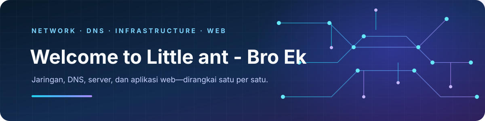

  

  
  <a href="https://app.midtrans.com/payment-links/b45ec2c9-80f7-4dd8-b2e9-e18d430d192e-7l5NTR4t">Traktir Eki Segelas Kopi</a>

## Sedikit tentang saya

Semut kecil di dunia jaringan, DNS, server, dan aplikasi web. Saya senang merangkai sistem satu per satu—kalau semuanya mendadak berjalan lancar, biasanya justru mulai curiga ada yang belum ketahuan.

## Yang sering saya utak-atik

### Jaringan

  
  
  
  
  
  
  

### DNS

  
  
  

### Linux, server, dan virtualisasi

  
  
  
  
  

### Container dan otomasi

  
  
  
  
  
  
  

### Monitoring

  
  
  

### Web development

  
  
  
  
  
  
  
  
  
  

### AI terapan untuk industri

  
  
  

Penerapan AI untuk membantu otomasi, monitoring, dan analisis proses operasional.

## Repo pilihan

  
  

  
  

## Statistik GitHub

  
  

  

## Dukungan anda berarti bagi saya untuk mengembangkan dan menemukan lebih banyak inspirasi.

[Traktir Eki Segelas Kopi](https://app.midtrans.com/payment-links/b45ec2c9-80f7-4dd8-b2e9-e18d430d192e-7l5NTR4t)

